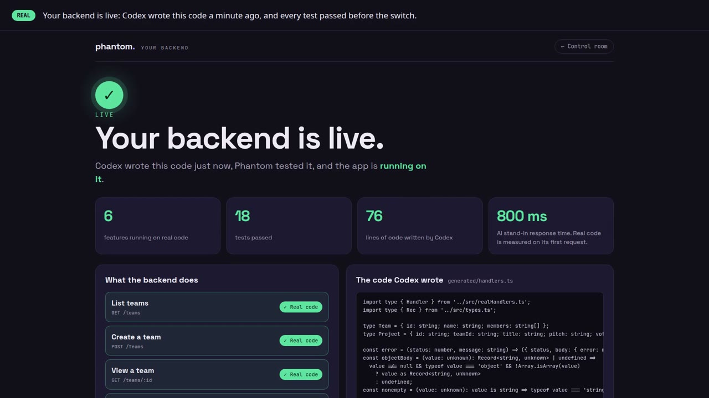
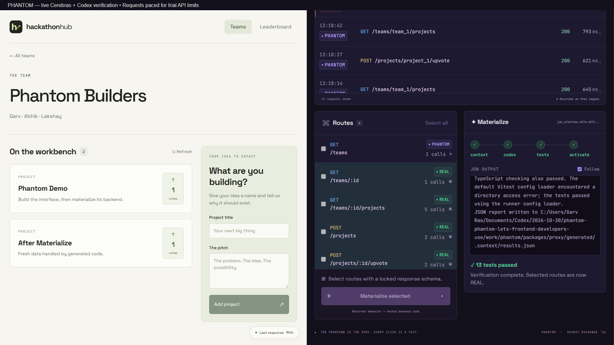

# Phantom

**Use a backend before it exists.**

Phantom sits between your frontend and a backend that hasn't been written yet. Unbuilt API calls are answered live by a fast model on Cerebras, backed by a real data store so data stays consistent. Every request is recorded. Press **Materialize** and Codex turns the recorded traffic into a real backend plus contract tests. Once the tests pass, Phantom switches traffic over, and the app doesn't notice.

> The frontend is the spec. Every click is a test.

## Demo video

[](docs/assets/phantom-demo.mp4)

**[▶ Watch the full live run (1:53)](docs/assets/phantom-demo.mp4).** It's a live run with real Cerebras and real Codex:
1. Create a team and a project and upvote it. There's no backend code; every call is PHANTOM.
2. Materialize 6 routes. Codex writes the handlers and tests, and **17/17** tests pass.
3. The routes flip to REAL, and new data is served by the generated code.

The only edit cuts a ~40 s pause where the recorder waited out the trial key's 5 requests/min limit. Materialize is shown in real time. Re-record it with `scripts/record-demo.mjs`.

## How it works

1. The frontend calls `/api/*` on the Phantom proxy.
2. If a real handler exists for the route, the call goes to it (**REAL**). Otherwise Phantom asks the model (**PHANTOM**).
3. The model returns `{ status, body, storeOps }`. Phantom validates the answer, applies the store changes itself, and locks the route's response shape.
4. Every exchange is recorded to `data/recordings.jsonl` and streamed to the dashboard.
5. **Materialize:** Codex writes handlers and tests from the recordings. Phantom runs the tests and flips the routes to REAL on a full pass.

## Trust rules

- The model proposes; our code decides. Only Phantom mutates the store.
- Response shapes are locked per route after the first success.
- Reads can't write, and new ids are reserved by Phantom.

## Team

Garv · Abhik · Lakshay

## Stack

Node + TypeScript, Fastify, Cerebras (`gpt-oss-120b`, OpenAI-compatible API), ajv, Server-Sent Events, Codex (`codex exec`), Vitest, React + Vite.

## Repo

| Path | What |
|---|---|
| `AGENTS.md` | Full build spec: contracts, modules, milestones, prompts |
| `docs/IMPLEMENTATION_PLAN.md` | Step-by-step build plan with reference code and who does what |
| `docs/DEMO_ON_WINDOWS.md` | **Demo laptop setup and run steps (Garv's Windows laptop)** |
| `docs/DEMO_AND_QA.md` | Walkthrough example, demo script, judge Q&A |
| `packages/proxy` | The Phantom proxy |
| `packages/dashboard` | Live request log and Materialize UI |
| `packages/demo-app` | Hackathon Hub, the demo frontend with no backend |

## Run locally

Requires Node 20+, pnpm, and a signed-in Codex CLI. Hosting and storage run locally; AI calls use your own hackathon access/credits.

1. Copy `.env.example` to `.env` and set `CEREBRAS_API_KEY` on the machine running Phantom. Never commit the key. A teammate's ignored `.env` is not transferred by GitHub.
2. Run `pnpm install`.
3. Run `node scripts/start-local.mjs` for the backend on port 4000.
4. Alternatively, use `pnpm dev` to start all packages together (proxy 4000, demo app 5173, dashboard 5174); stop the standalone backend first to free port 4000.

PowerShell: use `Copy-Item .env.example .env`; macOS/Linux: `cp .env.example .env`.

## Verification

```bash
pnpm -r test
pnpm --filter @phantom/proxy typecheck
node scripts/preflight.mjs
```

The preflight checks key and frontend presence without displaying credential values. It does not prove API access.

With the proxy running and a real Cerebras key loaded:

```bash
node scripts/smoke.mjs
```

To avoid affecting an active demo, run the isolated version instead: `node --env-file=.env packages/proxy/node_modules/tsx/dist/cli.mjs scripts/smoke-isolated.ts`. It starts a temporary server and store, then cleans them up.

**The ordinary smoke command resets development state.** It verifies persisted teams, distinct per-team reads, project creation, and three upvotes. Do not run against anyone else's active demo. API requests are paced 14 seconds apart by default for the trial key's rate limit; `PHANTOM_SMOKE_DELAY_MS` can adjust this after limits are confirmed.

### Backend handoff rehearsal

Stop the development proxy first. This temporarily replaces generated artifacts, restores them afterward, and uses an isolated store. The default uses scripted Cerebras input and **real Codex generation and real replay tests**:

```bash
node scripts/rehearse.mjs --runs=3
```

Results and genuine terminal recordings are saved in `data/rehearsals/`. They are backend-only evidence, not a UI demo video. To exercise real Cerebras too, load the local key:

```bash
node --env-file=.env scripts/rehearse.mjs --runs=3 --live-cerebras
```

Do not publish the scripted-input request latency as Cerebras latency. Generation timings are measured, not guaranteed.

## Current verification evidence

- Combined suite: 103 tests passing (66 proxy, 29 dashboard, 8 demo app); strict proxy TypeScript and both frontend builds pass.
- Materialize failure/activation harness: 8 tests passing.
- Real Codex generated and verified a one-route backend, then the real dispatcher created new data while preserving existing data. One measured run took 38.293 seconds, with 4 replay/generated tests passing.
- Three one-route rehearsals with live Cerebras and real Codex passed: handoff times 38.159s, 38.185s, 38.249s; initial API requests 717ms, 659ms, 907ms. Each run passed 4 tests and preserved data after switching to REAL. This is a small local sample, not a general benchmark.
- Live paced smoke passed all 14 requests, including distinct team cache entries, persisted records, and three upvotes.
- Both previously found issues are fixed: cache/replay keys include the actual path, and `phantom.notes.md` supplies the demo field contract.
- Five-route live HTTP rehearsal passed in 40.305 seconds with 12 generated/replay tests. Reset and duplicate-job requests returned 409 during generation.
- Full live browser verification passed: create team/project, vote, press Materialize, then create/vote on fresh data through REAL handlers. The dashboard showed 13 passing tests, with no API failures or browser page errors.
- See [team progress](docs/PROGRESS.md) for measured evidence and remaining limitations.

## Team coordination

Every contributor and coding agent must read and update [docs/PROGRESS.md](docs/PROGRESS.md). Ownership and interface rules are in [the implementation plan](docs/IMPLEMENTATION_PLAN.md). Update measured results only after executing the check; label scripted inputs and offline fallback recordings clearly.

Built at the DevDay Exchange Community Hackathon, New Delhi, 2026.

### Five-route HTTP rehearsal

With the proxy stopped, run `node --env-file=.env packages/proxy/node_modules/tsx/dist/cli.mjs scripts/verify-http-materialize.ts`. This uses real Cerebras, the actual Fastify HTTP handlers, and real Codex. It exercises five routes, checks reset/concurrent-job guards, and verifies new data after handoff. It is paced for the trial API limit. Failures save request/response/store evidence to ignored `data/http-rehearsal-failure.json`; success saves `data/http-rehearsal.json`. Frontend behavior is not covered.

## Live UI verification



This screenshot is from the real demo app and dashboard after live Cerebras responses, real Codex generation, and the independent test gate. API requests were paced to respect the trial limit; this is not evidence of unrestricted throughput. Five routes are materialized; the initial empty teams-list route remains PHANTOM until it has a non-empty schema sample.

Browser verification script: `scripts/verify-ui.mjs` (Playwright installed separately; optional `PHANTOM_PLAYWRIGHT_MODULE` points to its entry file). It uses real responses, captures a video and screenshots in `data/ui-recording/`, and asserts new requests are REAL after completion. Start all three apps on their usual ports first. Run on clean development data.

Final Windows acceptance run (1 Nov): all seven routes, including the leaderboard, materialized through real Cerebras and Codex in 37.862 seconds with 19/19 generated and independent replay tests. The new backend page showed the actual generated source. Reload recovery during generation, reset/concurrent-job guards, fresh REAL teams/projects, three votes, preserved earlier data, ranking order, distinct team reads, and clearing the backend page after reset all passed. No browser page errors or failed app API calls occurred. This is one measured local run, not a latency guarantee.

Reproduction: `scripts/verify-final-ui.mjs` requires Playwright (via `PHANTOM_PLAYWRIGHT_MODULE`) and clean isolated apps, defaulting to proxy 4100, Hub 5273, dashboard 5274. The URLs can be overridden with `PHANTOM_VERIFY_PROXY`, `PHANTOM_VERIFY_HUB`, and `PHANTOM_VERIFY_DASH`. Point both Vite apps at the isolated proxy with `PHANTOM_PROXY_TARGET`, and use a separate `PHANTOM_DATA_DIR`. Back up `packages/proxy/generated` before running and restore it afterward with the server stopped; generated artifacts are shared across proxy instances. Set `PHANTOM_VERIFY_RESET=1` only for an isolated instance to also test reset. Evidence goes to ignored `data/final-ui-verification/`.
